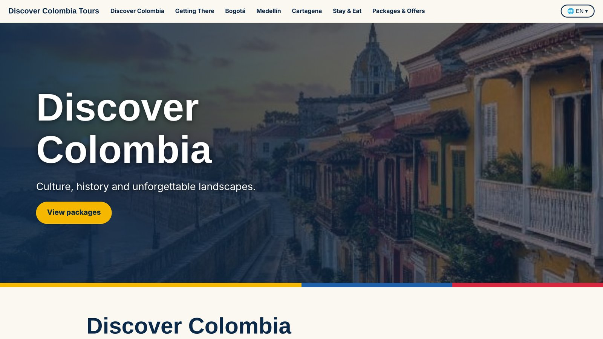
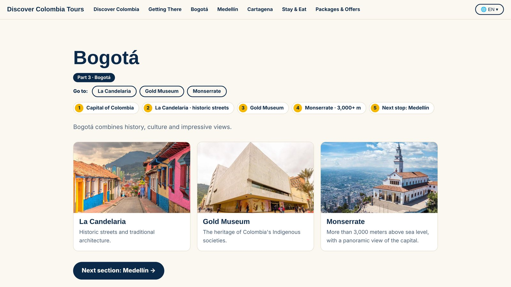
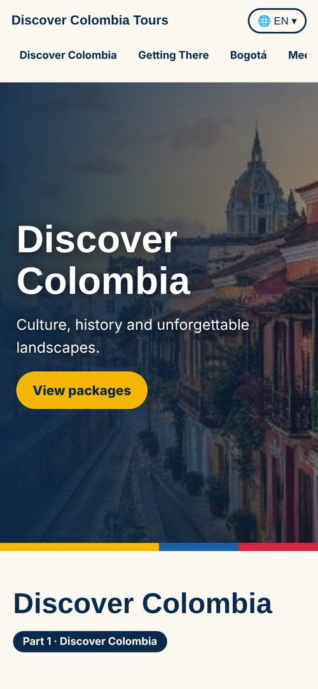

# 🇨🇴 Discover Colombia Tours

Site turístico em **3 idiomas (EN | PT-BR | ES)** sobre a Colômbia, criado como projeto acadêmico de Inglês (ADS, 3º semestre, Fatec Mococa) e **apresentado em sala de aula**, em inglês, para a turma e a professora.
*Trilingual tourist website about Colombia, built as an English class project (Systems Analysis and Development, 3rd semester) and **presented in class**, in English, to the teacher and classmates.*

🔗 **Demo:** https://julio122dev.github.io/discover-colombia-tours/

## 📸 Prévia / Preview

| Seção Bogotá (computador) | Celular |
|---|---|
|  |  |

## ✨ Recursos / Features
- Seletor de idioma em um único botão: English, Português (Brasil) e Español / One-button language switch
- 7 seções: Discover Colombia, Getting There, Bogotá, Medellín, Cartagena, Stay & Eat, Packages & Offers
- Menu em cada seção para ir direto ao item / Per-section quick menu
- Cards clicáveis (Cultura, História, Natureza e Gastronomia) com pop-up e link para o site oficial de turismo da Colômbia
- Seção de guia turístico com botão de WhatsApp e mensagem automática (o número no código é fictício)
- Animações ao rolar a página (scroll animations) e navegação por setas ← →
- Layout responsivo (notebook e celular) / Responsive layout
- Página única, sem frameworks: HTML + CSS + JavaScript puro / Single file, no frameworks

## 🛠️ Tecnologias / Tech
HTML5 · CSS3 (grid, flexbox, variáveis, modo escuro) · JavaScript (dicionário de traduções, IntersectionObserver, modal)

## 🔒 Boas práticas de segurança / Security notes
- Links externos com `rel="noopener"` (evita *reverse tabnabbing*)
- Sem scripts de terceiros; destinos de links fixos no código (sem *open redirect*)
- Número de WhatsApp real removido do repositório público / Real phone number removed from the public repo

## 👥 Equipe / Team
Projeto em grupo de 7 integrantes, cada um responsável por uma seção da apresentação.
*Group project: seven members, one presentation section each.*
<!-- Adicione aqui os nomes e links do LinkedIn de cada integrante -->

## ⚠️ Aviso / Disclaimer
Projeto acadêmico. Os preços dos pacotes são **simulações** e não representam uma oferta comercial real.
Marcas citadas (Avianca, Marriott, Hilton etc.) aparecem apenas como referência, sem vínculo com as empresas.
*Academic project. Package prices are simulated. Brand names are used only as references; no affiliation.*

## 📷 Créditos das fotos / Photo credits
Muralhas, Castillo de San Felipe e Playa Blanca: Wikimedia Commons (CC BY-SA).
Outras fotos: dicasdacolombia.com.br, TripAdvisor, restaurantecande.com e materiais fornecidos pelo grupo.
